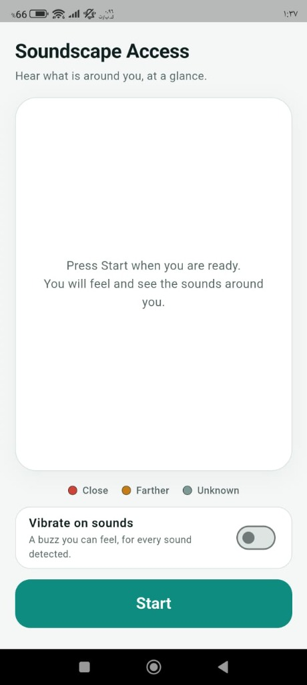
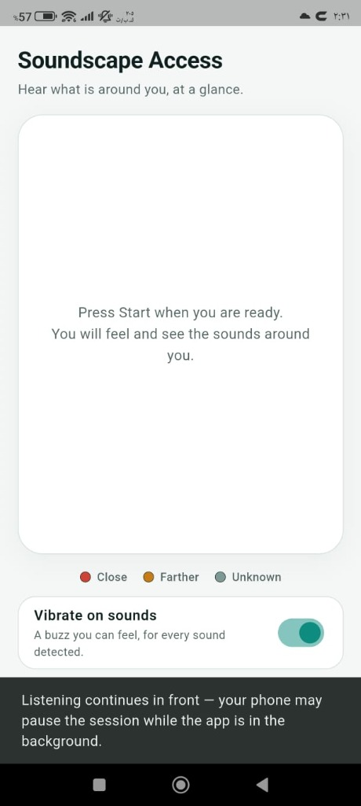
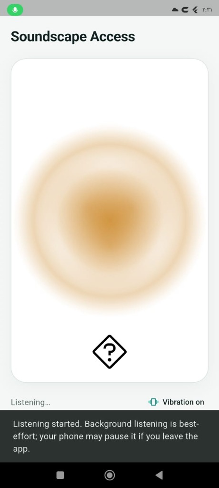

# Soundscape Access

**Turn the sounds around you into something you can see and feel.**

Soundscape Access is an Android accessibility app for deaf and
hard-of-hearing people. It listens to the environment and reports sounds
through a live visual pulse, category artwork, and optional vibration.

Audio classification runs on-device; the app has no account, server, or
cloud-classification integration. Ambient audio is processed locally and
is not uploaded by the app.

---

## App Interface

<p align="center">
  
  &nbsp;&nbsp;&nbsp;&nbsp;
  
  &nbsp;&nbsp;&nbsp;&nbsp;
  
</p>

*From left to right: (1) Setup screen with Start button and colour key, (2) Optional vibration toggle and background session notification, (3) Live session showing visual pulse and detected sound artwork (with fallback).*

---

## The problem

A person who cannot reliably hear the room may miss sounds that are
important in ordinary moments:

- **"What just happened?"** — sounds can arrive without a visual cue.
- **"How strong is it?"** — a visual pulse gives a non-auditory indication
  of sound level.
- **"Is it repeating?"** — the pulse describes repeated and continuous
  sound behavior.

Existing tools tend to be either research prototypes with no product
polish, or fixed single-purpose alerts. This project aims at a small,
coherent, genuinely usable screen: one tap to start, and the
environment starts describing itself.

## What it does

| Feature | Behaviour |
|---|---|
| **Start / Stop** | One large button. Microphone permission is requested once, with an explanation first. |
| **Sound pulse** | A soft mist cloud whose size, colour and rhythm follow the sound — grows with loudness, re-rolls a wave on every detected strike. |
| **Sound-type bubbles** | Up to a handful of labelled bubbles (car, speech, door, alarm, birds). A repeat sound refreshes its bubble rather than piling up duplicates. Swipe a bubble down to dismiss it. |
| **Vibration** | Each detected sound can also be felt. On/off is a single toggle. |
| **Colour key** | Close / Farther / Unknown is shown as words *and* swatches before the session starts — colour is never the only signal. |
| **Unknown, honestly** | When the model is not confident enough, the app says *unknown* instead of guessing a name. |

## What it deliberately does **not** do

**It does not tell you where a sound is coming from.**

This was attempted seriously and abandoned on evidence. Six runs
of an on-device two-microphone probe are represented by the repository's
timestamped research logs as
`probe_log.txt` … `probe_log_r6_direction.txt`. The first four rounds
are summarised in [`devpost/spec.md`](devpost/spec.md); the decisive
ones failed the criteria that were fixed *before* the test ran:

- the left/right axis produced the **same sign on both ends**;
- the *no-difference* control (source equidistant from both mics) came
  out **larger** than either end it should sit between;
- a fixed inter-channel offset of about −1.9 dB dominated every
  position regardless of where the source actually was.

A metric that reads loudest where the truth is "no difference" is not
measuring direction. Rather than ship a plausible-looking arrow that
was not actually measured, the feature was left out. The probe code
remains in the repository, gated behind a `const` flag, so the work is
reproducible.

## How it works

```
microphone  →  0.975 s windows  →  YAMNet (TensorFlow Lite, on-device)
                                       │
                          ┌────────────┴────────────┐
                          ▼                         ▼
                 5 categories + unknown     loudness / onset / rhythm
                          │                         │
                          ▼                         ▼
                   sound bubbles             sound pulse + vibration
```

- **Classification** — YAMNet scores are mapped by hand onto five
  categories (`cars`, `speech`, `door`, `alarm`, `birds`) using index
  sets built from the real `yamnet_class_map.csv`. Anything below the
  general confidence threshold (0.35) resolves to `unknown`. Door has an
  additional Knock-only fallback: a Knock score of at least 0.12 that is
  greater than Tap must occur in at least two of the last three completed
  inference windows before one Door event is added. This heuristic can
  still misclassify sounds; it does not guarantee accurate detection.
  Two strong categories at once produce two bubbles.
- **Behaviour** — loudness, onset (sudden vs gradual) and rhythm
  (continuous vs repeating) are measured from the level envelope, not
  guessed.
- **Rendering** — the pulse is deliberately *mist*, not a defined
  shape: a centre lobe plus three offset lobes, heavily blurred.

YAMNet is a general-purpose sound-event model, not a safety monitor.
Its scores are not calibrated probabilities, and classification accuracy
depends on the sound and recording conditions. Soundscape Access does not
identify a sound's direction and must not be relied on for emergency
warnings.

## Getting started

**Requirements**

- Flutter 3.44.6 stable with Dart 3.12.2 (the verified development
  toolchain; other versions are not verified here)
- Android SDK and build tools configured for Flutter
- An Android device (Xiaomi 12T Pro, Android 14 / API 34, was used for
  development; other devices/versions are not verified here)

**Run it**

```bash
flutter pub get
flutter run
```

**Build an APK**

```bash
flutter build apk --debug
```

## Testing

```bash
flutter analyze   # no issues
flutter test      # 43 tests in 5 test files
```

The current test suite covers category mapping and thresholds, Door's
rolling Knock confirmation, the skipped-inference versus Unknown
distinction, session/bubble rules, behavior analysis, vibration
event-triggering, and a widget test. These are automated tests; they do
not establish classification accuracy across real-world recordings or
devices.

## Planning documents

This project was built with the Devpost Learn Skill Pack. The three
generated planning documents are in the repository under [`devpost/`](devpost/):

| Document | Contents |
|---|---|
| [`devpost/scope.md`](devpost/scope.md) | The idea and what was cut out of it |
| [`devpost/prd.md`](devpost/prd.md) | Product definition: journeys, states, edge cases, boundaries |
| [`devpost/spec.md`](devpost/spec.md) | Technical blueprint: stack, components, data, file structure, decisions |

## Project structure

```
lib/
  audio/        microphone capture and permission flow
  analyze/      loudness, onset and rhythm from the level envelope
  classify/     YAMNet wrapper + category index mapping
  direction/    two-mic research probe (gated off by default)
  session/      session state, sound bubbles, vibration
  ui/           screen, sound pulse, bubbles
  theme.dart    light, high-contrast colour system
android/        native audio input + probe instrumentation
assets/model/   bundled YAMNet TFLite model and labels
devpost/        scope.md, prd.md, spec.md
probe_log*.txt  filtered on-device research traces (temporary service URLs redacted)
```

## Platform

Android only. iOS and desktop targets are not implemented.

The Android microphone foreground service is implemented, but background
capture can be restricted by Android versions and device power-management
policies. The app uses a foreground-session fallback; background listening
is not guaranteed on every device.

## License

Project source is licensed under [MIT](LICENSE). Bundled model, label,
sound-sample, and icon assets may have separate terms; verify their
provenance and required notices before redistributing them. This
repository does not currently include a separate asset-attribution
inventory.
